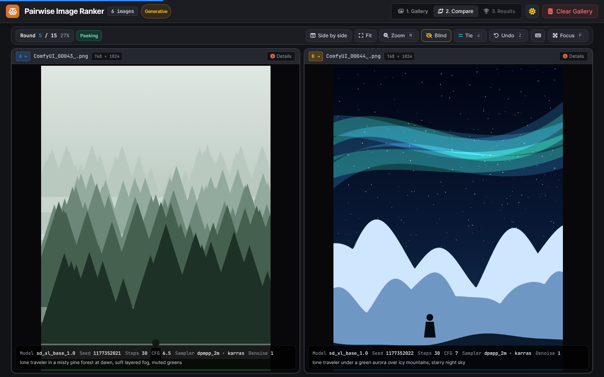
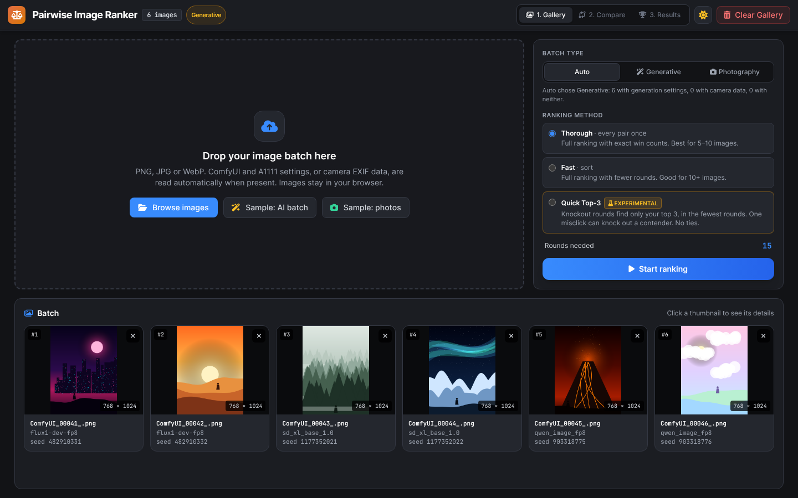
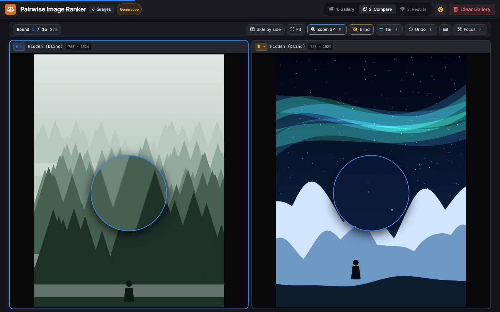
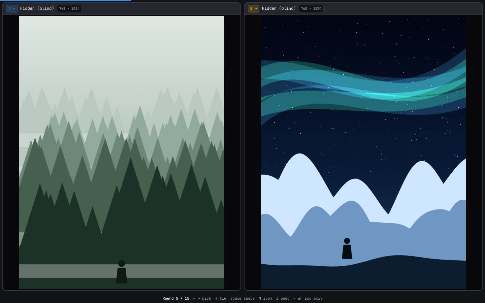
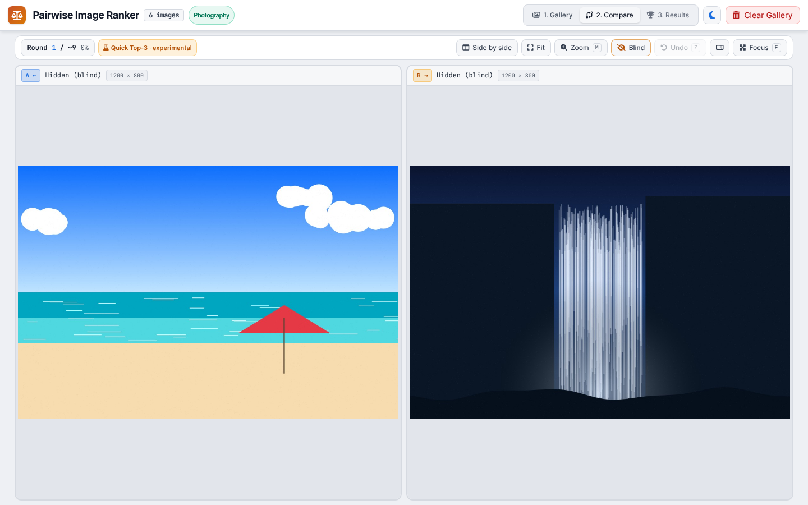
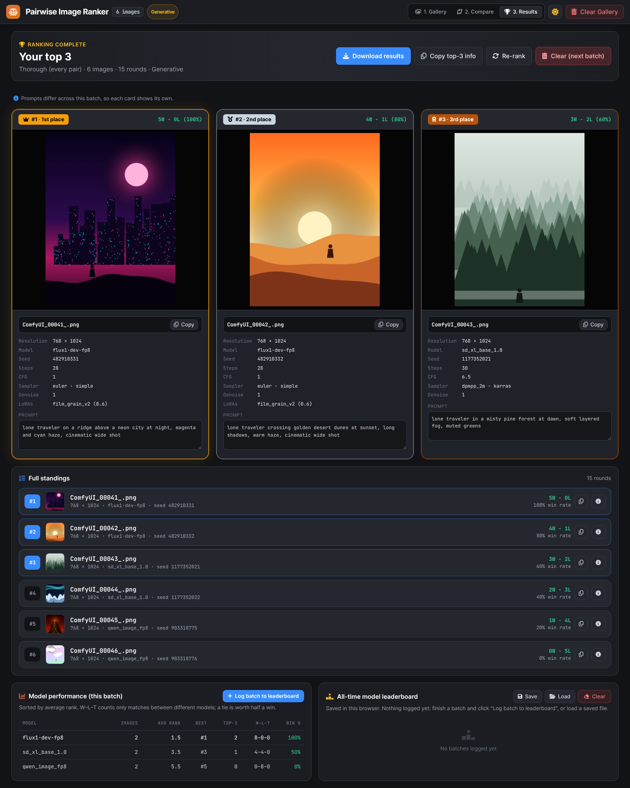
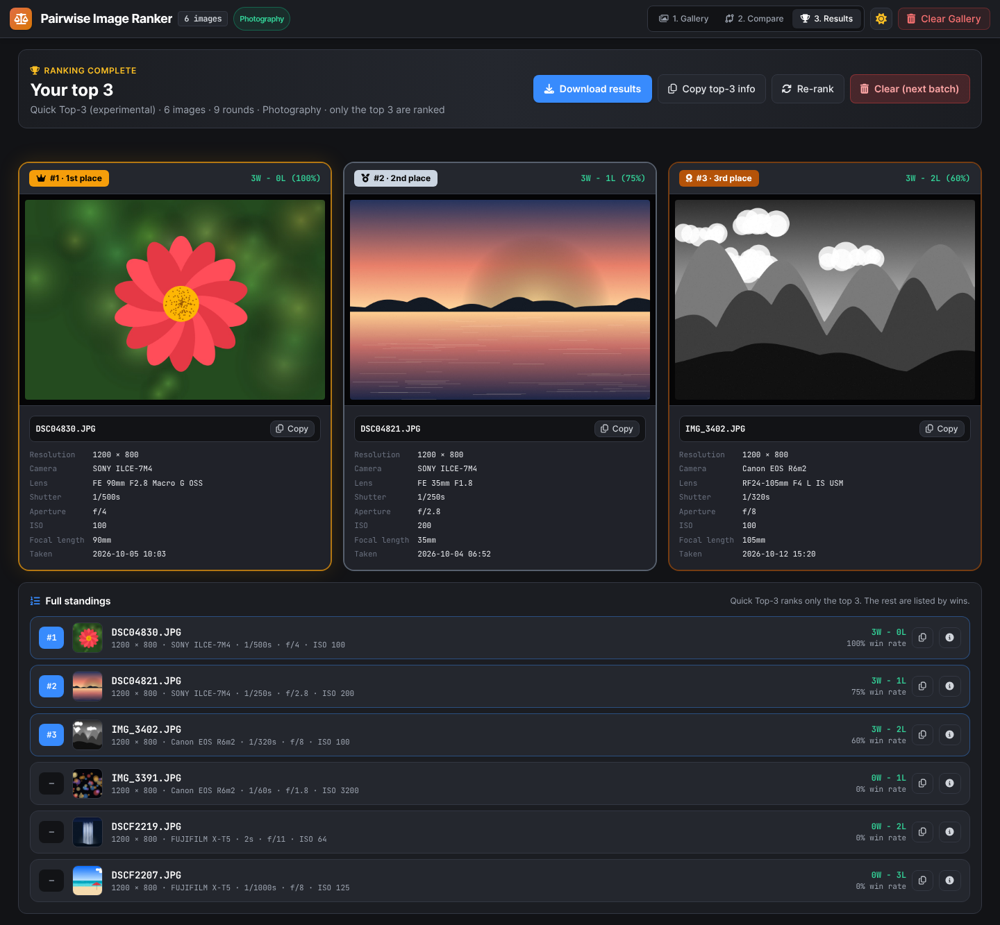
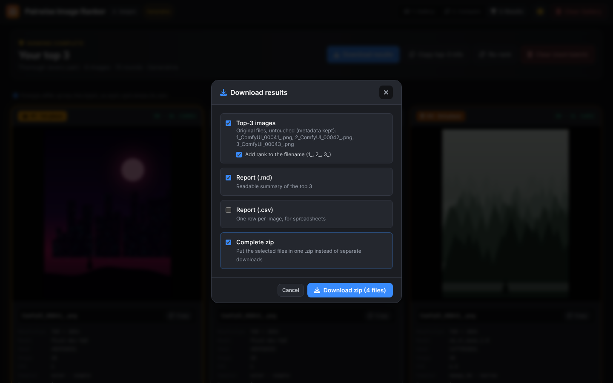

# Pairwise Image Ranker

Rank a batch of image variations by comparing two at a time. Get your top 3, with their settings.
One HTML file. Runs in your browser. Images are never uploaded. This tool was initially created to compare and rank images generated using ComfyUI.

## Quick start

1. Open `comfyui_pairwise_image_ranker.html` in Chrome, Edge or Firefox.
2. Drop your images on the drop zone.
3. Pick a ranking method, then click **Start ranking**.
4. Pick the better image each round: click it, or press **←** / **→**. Too close? Press **↓** for a tie.
5. Click **Download results**. Click **Clear Gallery** for the next batch.

No images handy? Click **Sample: AI batch** or **Sample: photos**.

## Keys

| Key | Does |
|---|---|
| **←** / **→** | Pick left / right |
| **↓** | Tie (each image gets half a point; not in Quick Top-3) |
| **Space** (hold) | Peek at specs while in Blind mode |
| **M** | Magnifier on/off (mouse wheel over an image = zoom) |
| **F** | Focus mode: only the two images |
| **Z** or **Ctrl+Z** / **⌘Z** | Undo last pick |
| **I** | Show the shortcuts |
| **Esc** | Close a dialog, or leave Focus mode |

## Batch types

| Type | Shows | Picked automatically when |
|---|---|---|
| **Generative** | Model, seed, steps, CFG, sampler, denoise, LoRAs, prompt | Any image has ComfyUI or A1111 settings |
| **Photography** | Camera, lens, shutter, aperture, ISO, focal length, date taken | Otherwise |

- Switch with **Batch type** in the gallery: **Auto**, **Generative** or **Photography**.
- Only fields an image actually has are shown. Every image gets filename and resolution.

## Ranking methods

| Method | Rounds for 6 / 10 / 20 images | Use when |
|---|---|---|
| **Thorough** (default) | 15 / 45 / 190 | You want the most reliable full ranking. |
| **Fast** | ~11 / ~25 / ~68 | Big batches. Full ranking, fewer rounds. |
| **Quick Top-3** (experimental) | ~9 / ~15 / ~27 | You only need the best 3. |

**Quick Top-3** runs knockout rounds to find #1, then replays only the images #1 beat to find #2, and the same again for #3.
- Trade-off: one misclick can knock out a strong image.
- No ties.
- Images outside the top 3 aren't ranked.

## During ranking

- **Thin line at the top** = progress.
- **Blind** is on by default: filenames and settings are hidden. Hold **Space** to peek. Settings never affect the ranking.
- **Fit** keeps both images in the window. **Fill width** makes them bigger (the page scrolls).
- **Side by side** suits portrait images. **Stacked** suits wide ones.
- **Zoom (M):** hover one image and the same spot is magnified on both.
- **Focus (F):** fullscreen with just the images. **Esc** to leave.

| Magnifier (M) | Focus mode (F) |
|---|---|
|  |  |

## Results

- **Rank score:** `#1 (4W - 1L - 1T, 75%)`. A tie counts as half a win.
- **Shared ranks (`#3=`):** images on equal points share a rank. If a shared rank crosses the top-3 cut, a note names the tied images. Pick whichever you prefer.
- **Prompt (Generative):** one box if every image has the same prompt, otherwise each card shows its own. All are editable; edits go into the exports.

| Generative | Photography |
|---|---|
|  |  |

## Download results

Click **Download results** and tick what you want:

- **Top-3 images:** the original files, untouched (metadata kept). Optional rank prefix `1_`, `2_`, `3_`.
- **Report (.md)** and **Report (.csv)**.
- **Complete zip:** puts everything ticked into one `.zip`.

The browser can't delete your other files; do that yourself.

## Comparing models (Generative only)

Put several models in one batch, using the same prompt.

- **Model performance:** how each model did in this batch. W–L–T counts only matches against *other* models.
- **Log batch to leaderboard:** adds the batch to the **All-time model leaderboard**. One log per run.
- **Save** downloads the leaderboard as `.json`.
- **Load** opens a saved `.json`, then you choose **Merge with current** or **Replace current**.
- **Clear:** click twice to wipe it.

## Saved automatically

- **Your batch and progress survive a refresh.** This covers images, picks, prompt edits and view settings.
- **Clear Gallery** deletes the saved batch.
- The leaderboard is saved until you clear it.
- Saving is per browser. A different browser or a private window starts empty.

## Metadata

- **Generative:** read from PNGs saved by ComfyUI or A1111/Forge.
- **Photography:** EXIF read from JPEG, PNG and WebP.

Fields missing? The file was likely re-saved or sent through a chat app, which strips metadata. Use the original file.

## Troubleshooting

| Problem | Fix |
|---|---|
| Arrow keys don't vote | Click an empty spot on the page first. |
| Added or removed an image mid-ranking | The ranking resets, since the batch changed. Start again. |
| Prompt is wrong or empty | Edit it on the results card. |
| Focus mode isn't fullscreen | Your browser blocked fullscreen. Focus mode still hides everything else. |
| Several downloads, browser asks to allow them | Click Allow, or tick **Complete zip** for a single file. |
| No icons | You're offline. Everything else still works. |
| "Could not save this batch" message | Browser storage is full or blocked. Ranking still works; it just won't survive a refresh. |
